# CycleNav+

### Cycling and transit navigation for Germany

CycleNav+ is an Android app built specifically for cycling and
transit in Germany. It combines route planning, turn-by-turn
navigation, selected offline features and live location sharing.

This public repository contains demo information and APK downloads.
The application source code is private.

## Download the Android demo

[View release notes](https://github.com/Noorwithcode/cyclenav-demo/releases/tag/v1.0.0)

- **Version:** 1.0.0 — demo / pre-release
- **Platform:** Android, ARM64 devices only
- **Download size:** approximately 49 MB
- **Region:** Germany
- Runs without Metro, USB or a PC connection
 Internet is required for account services and online features
 <h2>App screenshots</h2>

<table>
  <tr>
    <th>Home</th>
    <th>Route preview</th>
  </tr>
  <tr>
    <td>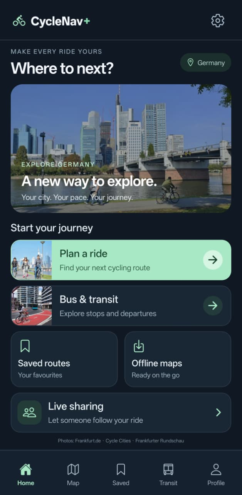</td>
    <td></td>
  </tr>
  <tr>
    <th>Simulation — satellite</th>
    <th>Simulation — map</th>
  </tr>
  <tr>
    <td>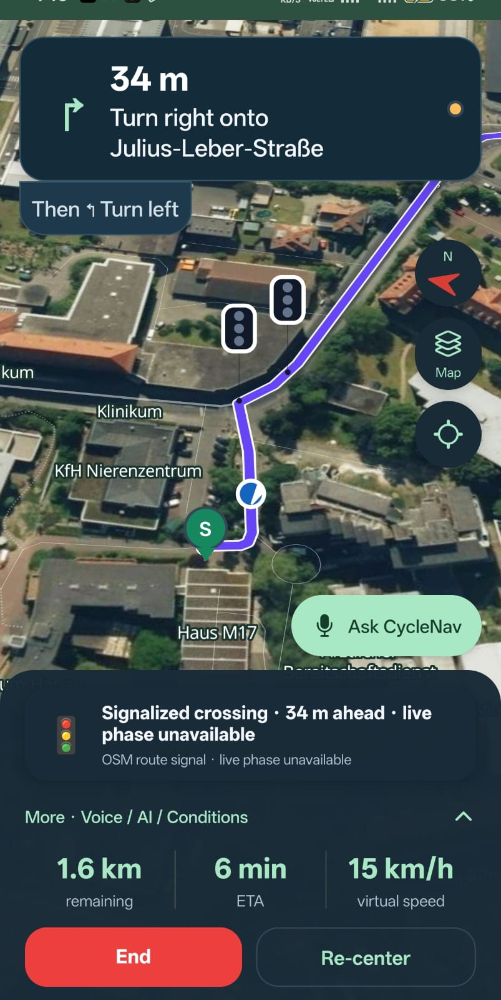</td>
    <td>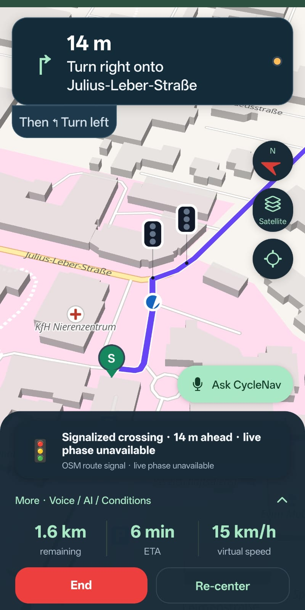</td>
  </tr>
</table>
Navigation screenshots show ride simulation.
Traffic-signal markers indicate mapped locations; live phases are unavailable.

<h2>Live location sharing</h2>
<table>
  <tr>
    <th>Live Share</th>
    <th>Location preview</th>
  </tr>
  <tr>
    <td>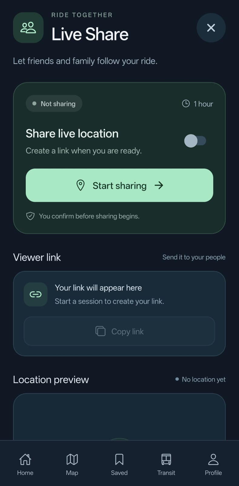</td>
    <td>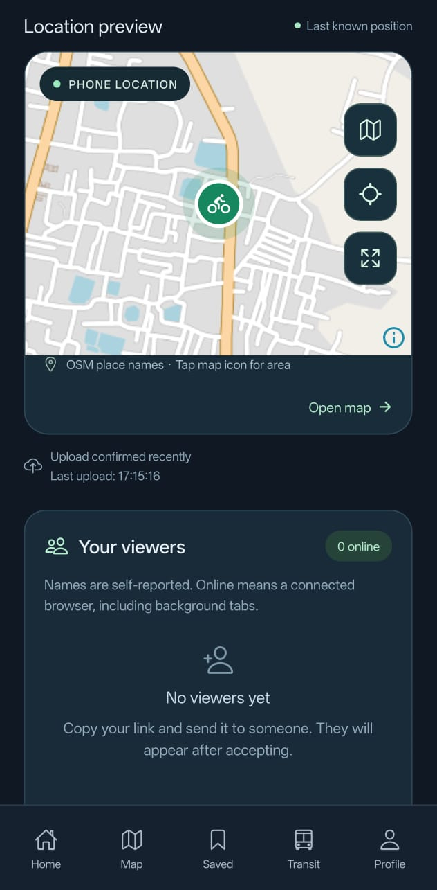</td>
  </tr>
  <tr>
    <th>Sharing controls</th>
    <th>Browser viewer</th>
  </tr>
  <tr>
    <td>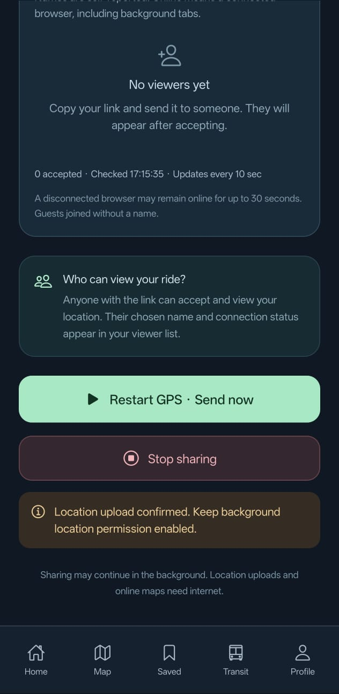</td>
    <td>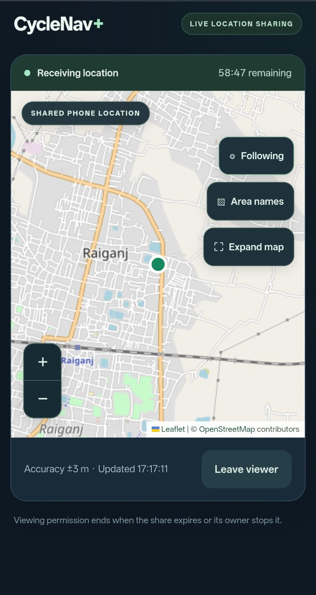</td>
  </tr>
</table>

Live sharing was tested in Raiganj, India.
Cycling and transit features are intended for Germany.
Viewer names are self-reported; online status indicates a connected browser.

<h2>Transit</h2>

<table>
  <tr>
    <th>Find a stop</th>
    <th>Departures</th>
  </tr>
  <tr>
    <td>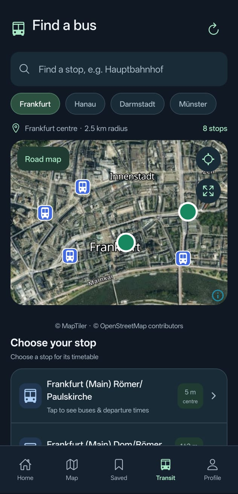</td>
    <td>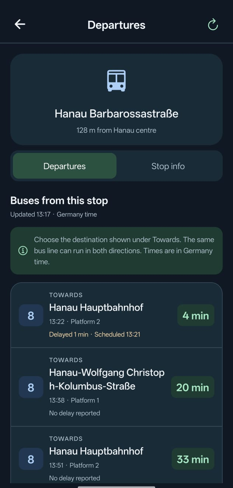</td>
  </tr>
</table>

Find stops on the map and view departures by direction.
Departure times are displayed in Germany time.
Availability and delay information depend on the transit provider.

<h2>Saved routes</h2>

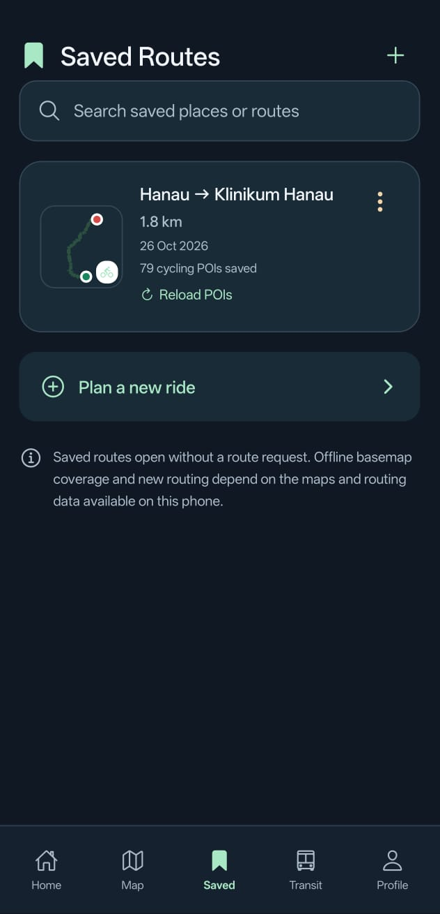

Save routes for later with a route thumbnail, distance and saved cycling POIs.
Saved routes reopen without a new route request.
Offline maps and new routing depend on the datasets available on the device.

<h2>Offline maps</h2>

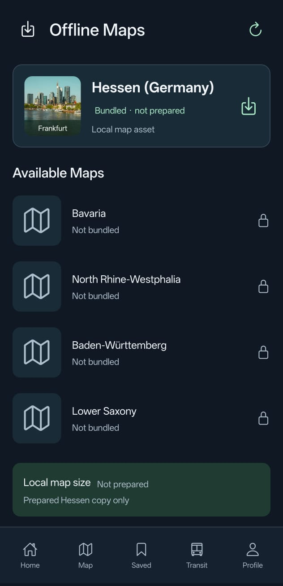

Prepare the bundled Hessen map for offline use.
This screenshot shows the map before preparation.
Other listed regions are not bundled in this demo.
Offline routing is limited to supported pilot datasets.

<h2>AI route guide</h2>

<table>
  <tr>
    <th>Ask about your route</th>
    <th>Spoken route answer</th>
  </tr>
  <tr>
    <td>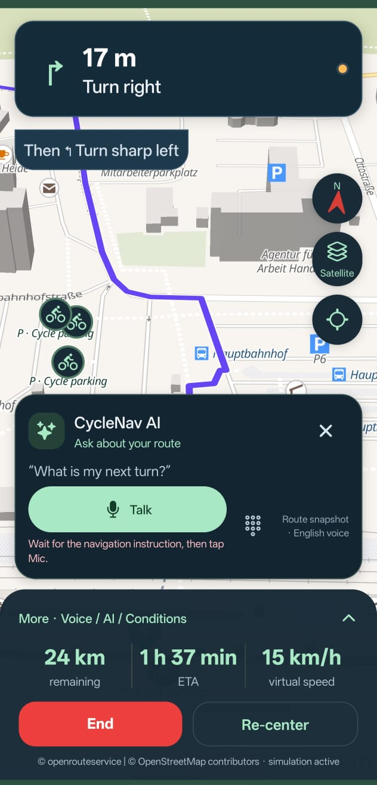</td>
    <td>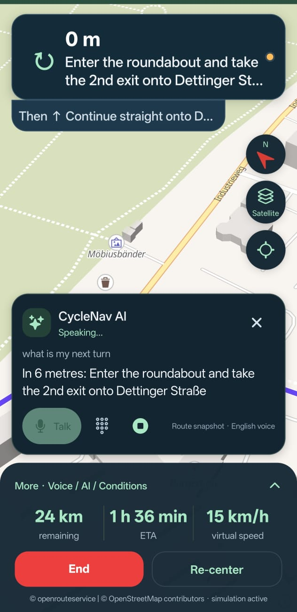</td>
  </tr>
</table>

Ask route questions by voice and hear spoken guidance.
These screenshots show navigation simulation and a route-snapshot answer.
AI provider availability and response times may vary.

## Features

- Account registration and login
- Cycling route preview and turn-by-turn navigation
- Ride simulation, off-route detection and rerouting
- Selected-route traffic-signal location markers
- Cycling points of interest
- Saved routes and offline maps
- Pilot offline routing for supported datasets
- Transit planning and fullscreen maps
- Live location sharing with a browser-based viewer
- Viewer names and connection status
- Dark mobile interface

## Install and try

1. Download the APK using the button above.
2. Open it on a compatible ARM64 Android device.
3. Allow installation from your browser or file manager if Android asks.
4. Install and open CycleNav+.
5. Register an account and log in.
6. Select a supported location in Germany to explore route planning.
7. Allow location access when using navigation.
8. For background live sharing, allow background location access.

Cycling routes, transit services and offline routing datasets are
intended for Germany. Turn-by-turn navigation requires an appropriate
GPS position near the selected route.

Background location behavior can vary with Android battery settings
and device restrictions.

## Try live location sharing

1. Open Live Share in the mobile app.
2. Start sharing and wait for a confirmed location upload.
3. Copy the generated viewer link.
4. Open the link in another browser or device.
5. Enter a display name and accept the invitation.
6. Stop Sharing in the app to close viewer access.

Viewer links provide access to the shared location until the share
expires or is stopped. Share them only with intended viewers.

Viewer names are self-reported. Online status indicates a connected
browser, not confirmation that someone is watching.

The viewer website displays shared locations. The full cycling and
transit experience is available in the Android app.

## Germany coverage and limitations

- Cycling and transit support is limited to Germany.
- Feature availability varies by city, provider and dataset.
- Cloud cycling POIs currently cover Frankfurt and Hanau.
- The OSM traffic-signal catalog contains 5,586 mapped locations
  across Frankfurt and Hanau.
- Traffic-signal markers show locations, not live phases or countdowns.
- Geometric signal matching does not establish lane-specific ownership.
- Offline routing is limited to supported pilot datasets and contexts.
- Offline features require the relevant datasets to be available
  on the device.
- POIs elsewhere in Germany require the configured local backend.
- AI guide availability depends on the backend AI provider.
- Online features depend on backend availability and provider quotas.

## Technology

| Component | Technologies |
|---|---|
| Mobile app | React Native, Expo, TypeScript |
| Mobile maps | MapLibre |
| Backend | NestJS |
| Database | PostgreSQL, PostGIS |

## Feedback

Report demo issues through this repository's
[Issues page](https://github.com/Noorwithcode/cyclenav-demo/issues).

Include your device model, Android version and steps to reproduce.
For routing issues, include the German city and public start/destination
places used for testing.

Do not include passwords, access tokens, home addresses or active
location-sharing links.

## Source code

The mobile application and backend source code are maintained in
a separate private repository. This repository provides the public
demo and Android downloads.

## Attribution

Map data includes © OpenStreetMap contributors.
Online routing uses openrouteservice where configured.
Home photo credits are displayed in the app.
